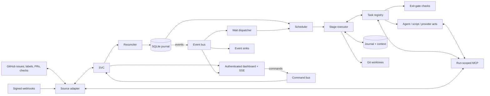

# Architecture

How Conveyor is built and why it behaves as it does. For using it, start with the [README](../README.md) and [operations.md](operations.md).

## Design principles

- **GitHub is authoritative.** Issues, labels, relationships, pull requests, and checks are reconciled from the source rather than replaced by a second issue tracker.
- **Configuration defines behavior.** Stages, agents, checks, concurrency, retry policy, labels, and lifecycle actions live outside managed repositories.
- **Every stage ends in a deterministic gate.** Gates are code over structured evidence (criterion approvals, review findings, CI results, script results), not AI judgement: the same state gives the same answer and every failure says what is missing. Judgement stays in the working agents, and its evidence is recorded for the gate to check. Native stages have no AI verifier.
- **Runs are least-privilege.** Every agent receives a per-run MCP server exposing only its configured tools and issue context.
- **Work is isolated.** Feature changes happen in Git worktrees; Conveyor does not edit a repository's primary checkout.
- **Progress is durable.** SQLite journals runs, attempts, transitions, questions, costs, source mutations, conversation messages, and every task execution with the context it ran against.
- **External mutations are idempotent.** Each act records a planned execution before it changes anything, observes external state first and does only the missing work, so a crash between a side effect and its record is repaired rather than repeated. For pull-request descriptions, recovery rereads the managed section before patching the provider, so a write that succeeded just before a crash is recorded without a second provider update.
- **Small core, replaceable modules.** The core holds configuration, the item lifecycle, execution, commands and events. Everything that talks to the outside (item source, code host, CI, agent harnesses, the dashboard) is a module behind small interfaces (ports), so a provider can be replaced or several can run side by side. See [Modules and ports](#modules-and-ports).
- **Commands in, events out.** The dashboard and the CLI send commands; every change of state is recorded as an event in the same transaction; reactions (scheduling, waking waits, the live dashboard, event sinks) subscribe to events. Any change can be traced, and a new consumer needs no change to the core.
- **Humans stay in control.** Conveyor never directly closes an ordinary issue. Its only direct-close exception is an active roll-up parent after all descendants satisfy the completion rule; it first records the parent done and closes it with GitHub's `completed` reason. Other completed open issues remain closable for an owner or an ordinary PR reference.

## Components



### Engine components

| Component | Responsibility |
| --- | --- |
| Configuration loader | Composes the `conveyor.yaml` entrypoint and the files its `!include` / `!secret` tags name, resolves paths relative to the file that declares them, validates cross-references with file-and-key-path errors, and computes a stable configuration hash. |
| GitHub source adapter | Reads issues and relationships, manages only configured labels/body sections, observes pull requests and checks, verifies webhooks, and performs idempotent source actions. |
| Reconciler | Rebuilds the local projection from GitHub and detects enrollment and label drift. Polling reads every issue; an issue or relationship delivery is acknowledged at once and reconciled in the background, reading only the issues it names, with deliveries that arrive meanwhile joining one pass. CI and pull request deliveries do not reconcile. Deliveries for Conveyor's own status comments are ignored. A deleted or transferred issue counts as one with no Conveyor labels: an `issues.deleted` or `issues.transferred` delivery purges its item at once, aborting its run before any further GitHub request, and a read by number answered 404 or 410 does the same; a listing that omits a stored issue only triggers that read by number, and any other failure (5xx, network) leaves the item unchanged. Nothing is ever marked missing. For a repository with a managed webhook there is no periodic pass. All GitHub reads go through a copy kept in the database (`src/plugins/github/shared/read-cache.ts`), answered from it within each kind's lifetime and kept current by deliveries and Conveyor's own writes; startup reads only the issues changed since the newest stored change. The dashboard, control socket, and live health endpoint start before the initial reconciliation, while readiness stays false until every repository has completed it. A polling repository is read in full periodically. A superuser can read one repository afresh with Sync now. |
| Event log and bus | Records every change as an event in its transaction (the log in `src/db/event-log.ts`, the catalogue and bus in `src/events`), publishes committed events in order to in-process subscribers and delivers them to sinks from durable cursors. Events are facts (Conveyor's changes), ingest events (what a plugin observed) or traces (the service's own activity, kept for a day); an event recorded by a subscriber names the event it reacted to as its cause. |
| Command bus | The one way in for dashboard and CLI actions (`src/commands`): validation, server-side role checks, correlation, accepted/rejected events. |
| Wait dispatcher | Wakes parked tasks whose wait subscriptions match an event (a commit's CI finishing, a pull request changing, a tracked blocker changing); a fallback deadline covers a lost delivery. |
| Scheduler | Selects eligible issues while enforcing global, repository, and stage concurrency plus parent/dependency constraints. |
| Workspace manager | Creates issue-specific Git worktrees and branches without changing the primary checkout. |
| Task registry | One registry of named tasks in the groups `item`, `workspace`, `change`, `ci`, `agent`, `script`, `conversation`, `todo` (and `legacy`). Each task declares its kind (`load`, `check`, `act`, `tool`), what it reads, writes and invalidates, and its schema. The MCP server, the stage executor and the generated [tasks.md](tasks.md) all read it. |
| Plan compiler | Turns a pipeline, a repository (CI mode, overrides) and the registry into an expanded execution plan, rejecting unknown tasks, duplicate instance ids, invalid dataflow and invalid routes at load time. `conveyor config check` prints the plan. |
| Stage executor | Runs one compiled stage as a durable task chain: implicit loads, journaled acts, the exit gate, waiting, `onFail` routing, retries and the `maxReturns` guard. |
| Execution journal | Persists the item context and its append-only history, each task execution with its idempotency key, the stage cursor, stage epochs (fencing tokens) and persisted wake-ups. |
| Legacy compatibility compiler | Compiles the deprecated `run` / `enterCheck` / `exitCheck` stage shape into a task plan (`legacy.*` tasks) so existing configurations keep working. |
| Harness (Codex, Claude Code) | Starts non-interactive structured agent runs with a chosen model, effort level, sandbox, approvals policy, output schema, scoped MCP configuration and, where the harness advertises it, session resume after a question. Both harnesses use the same empty-root Bubblewrap filesystem plan, exposing only each run's declared paths and tools. |
| JSON-process runner | Executes repository-defined programs that accept JSON on stdin and return exactly one validated JSON result. |
| Scoped MCP server | Serves the registry's `tool` tasks to each live run under an exact grant, through one dispatcher that re-checks the grant and preconditions. Grants expire with the run. |
| Agent isolation | Sanitized agent environment and, per repository, a network namespace with allowlisting proxies (`src/isolation`). |
| SQLite store | Persists source projections, stage state, events, transitions, runs and their logs, questions and conversations, costs, review findings, criterion approvals, advisory CI watches and idempotency records in WAL mode. |
| Web control plane | Serves the authenticated dashboard application (a Preact application that runs in the browser), its JSON endpoints for issue conversations, stage history, technical logs, views and steering runs, health endpoints, and the live SSE stream. The dashboard is a presentation plugin (`src/plugins/dashboard`): it builds its view models from `DashboardSources` (`src/app/dashboard-sources.ts`: the store reads it makes, the configuration and the service's live state), never from the service or the whole store, and serves them to the routes. Its live model (`src/plugins/dashboard/feed.ts`, `src/web/model.ts`) follows the event bus, is rebuilt once per burst of changes and is sent as a snapshot plus field-level patches (`/api/v1/snapshot`, `/api/v1/stream`), so the work per change does not grow with the number of open dashboards. |
| Control interface and releases | Serves the CLI over a private Unix socket with the same operations as the dashboard; drains, backs up, switches the installed release and restarts under systemd for upgrades and rollbacks (`src/control`). |
| Service logging | Structured, redacted service logs on stdout/stderr and in a rotated JSON-lines file (`src/log`). |

## Modules and ports

Conveyor is moving to a small core with replaceable modules (#667). This section is the target and
the rule new code follows; the current state is tracked by the boundary test.

- **Core:** configuration and the module registry, the item lifecycle (stage, state, epoch,
  enrollment, roll-ups) in provider-neutral words (item, change, check, marker), scheduling and the
  stage executor with its journal, the command bus, and the event log and bus.
- **Ports:** small interfaces, each shaped by what its consumer needs. One implementation may
  provide many of them.

| Role | Ports today | Implementations |
| --- | --- | --- |
| Item source | `IssueSourceAdapter` (`src/source/types.ts`); more to come: reading, markers, relations, sections, comments, lifecycle, trust | GitHub Issues |
| Code host | `CodeHost` (`src/codehost/types.ts`) | GitHub pull requests |
| CI | `CiProvider` (`src/app/ci-provider.ts`) | GitHub Actions |
| Agent harness | `Harness` (`src/harness/types.ts`) | Codex, Claude Code |
| Presentation | `DashboardSources` (`src/app/dashboard-sources.ts`) in, `DashboardReads` (`src/web/server.ts`) out | The web dashboard |
| Storage | Per-domain store ports (`src/db/ports.ts`): items, journal, evidence, events, run logs, conversations, provider cache, webhook deliveries, accounts, reports; `ConveyorStore` implements them all | SQLite |

- **Plugins** live in their own folders (`src/plugins/<provider>/<role>/`) and are selected by
  configuration `type` per role, so a repository can combine, for example, items from one provider
  with code and CI from another. The contract and registry are in `src/core/plugins.ts`; the code
  host, CI, harness and presentation (the dashboard) roles are plugins today, and the item source
  becomes one with its ports.
  `src/plugins/index.ts` lists them and the composition root (`src/cli/commands/serve.ts`) is the
  only place that registers them. Plugins of one provider share a client through the plugin
  context, never by importing each other. Each item source, code host and CI plugin owns its
  configuration schema: the core schema knows only an entry's `type`, and loading the configuration
  validates the rest with the plugin's schema.
- **Events:** plugins report what they observe as events; the core compares them with what it
  knows, records the change, and emits its own events, which other modules (the dashboard among
  them) consume. Writes stay direct calls through ports, and every write is recorded as an event.
  Webhooks work this way today: the item source plugin's webhook receiver verifies a delivery and
  reads it into neutral `ingest` events (`itemSource.itemChanged` carries the issue as delivered,
  `code.changeUpdated`, `ci.runUpdated`, …); the core records them with the delivery, applies a
  delivered item if it is newer than its copy, and otherwise reads only the items an event names.
- **Enforcement:** `tests/scripts/architecture-boundaries.test.ts` fails when code outside an
  implementation or the composition root imports a provider or harness implementation, when a
  plugin imports another plugin, or when code outside `src/db` uses SQLite. Existing violations are
  listed in `scripts/architecture-allowlist.json`, which may only shrink.

## Issue and pipeline model

An issue is enrolled with the configured base label (by default `conveyor`). A stage label such as `conveyor:implementation` projects it into a pipeline stage. State labels represent stopped or terminal conditions, and an order label provides durable backlog ordering.

The `conveyor:paused` label pauses an item without erasing it: its running agent is stopped, nothing new starts for it, and its `conveyor` and stage labels stay; removing the label resumes the same stage. Removing the enrollment label (or closing the issue without a merged change, after Conveyor removes its labels) purges the item: its run is killed at once, its workspace, worktree and branch are removed (a restart finishes an interrupted purge without repeating anything), and every database row of it is deleted. The event log keeps its events. Adding the label again onboards the issue as a new item. Purged items are not on the dashboard, and no `missing` or `offboarded` state exists. Ambiguous, unknown, or conflicting labels are shown under **Label problems** rather than guessed.

Parents are roll-ups: current child links prevent new parent runs, except that a stopped stage that creates children can be retried to finish an interrupted creation. A run that was already active may finish or resume an answer it asked. Otherwise, a parent's source stage and board column follow the earliest pipeline stage occupied by an unfinished child, except while its own result is stopped or a run is active. A stopped parent in a child-creation stage offers retry; a parent already waiting on its children offers resume waiting instead. Once every nested descendant is done, or closed without a merged Conveyor pull request, Conveyor marks an active open parent done and closes only that parent with GitHub's `completed` reason. A merged child in post-merge work remains unfinished, and paused or already closed parents are never closed. The board separates roll-ups from executable issues within that column. Dependencies prevent an issue from running until the required issues are satisfied. The built-in pipeline records a proposed child breakdown during refinement, reviews it while the item is still ordinary, then creates only the approved entries in a separate work-breakdown stage. Custom pipelines can retain direct child creation unless they opt into those tasks.

During refinement and breakdown review, write acceptance criteria that are atomic: each criterion states one condition with one expected outcome. Give each distinct case in a requirement its own criterion. When a criterion's proof depends on a real boundary, name that boundary so implementation and review exercise the right behavior. An ordinary implementation item should target about six one-behavior criteria. Split an item that needs more than eight criteria unless its behaviors cannot ship separately.

Every stage is two task lists:

- **`actions`** do the stage's job: run an agent, run a script, ensure a workspace, push and open a change request, start CI, merge.
- **`exit-gate`** proves it is done and must not be empty: checks that read the loaded context and return `pass`, `pending` or `fail`. Conditions the next stage needs belong to the previous exit gate; there are no entrance gates.

A passing gate advances the item. A `pending` check parks the item (releasing its permits) and the whole gate is re-evaluated with fresh data after the task's poll interval or an earlier webhook; actions are not repeated. A native gate entry with `manual: true` parks after that task's automatic check passes until a superuser gives a CSRF-protected approval. Separately, a superuser can require one board approval for an item and native stage. It is a final synthetic gate: it waits only after every configured exit-gate task has passed, including configured manual gates. The two receipts are independent. A configured-manual receipt is bound to the item, task, and stage visit; a board receipt is bound to the item, stage, and visit. Both need a fresh approval after a retry, return, or plan restart. A `fail` is routed by `onFail`: `retry` (the default for the gate, bounded by the stage's `retries`; the actions run again with the failure as feedback), `{ return: <stage> }` (for example review findings returning to implementation, bounded by `settings.maxReturns`), or `{ stop: <state> }`. An action that fails stops as `blocked` unless configured otherwise. A thrown error is an infrastructure error with its own bounded retry policy, not a domain failure. The task reference, with the script protocol, is [tasks.md](tasks.md), generated from the registry.

A stage that uses `run`, `enterCheck` and `exitCheck` is the deprecated legacy shape, which still loads (see [the configuration reference](configuration.md#legacy-configuration-deprecated-still-supported)).

## Run-scoped MCP

Agents never receive unrestricted control-plane access. Conveyor creates an ephemeral MCP context containing the current issue, repository, workspace, delivery state, source guidance, and an allowlist selected from:

- read tools for the issue, workspace, delivery state, and shared conversation;
- user-facing progress, questions, blockers, milestones, rationale, results, and artifacts;
- constrained label, acceptance-criteria, hierarchy, dependency, comment, and managed pull-request-description changes;
- scoped workspace fetch, push, and artifact operations;
- read-only CI logs and review findings.

Tools are the registry's `tool` tasks, named in camelCase:

- `item.*`: `get`, `comment`, `setCriteria`, `setTitle`, `setSystemLabels`, `setType`, `setFields`, `setRefinement`, `setParent`, `setDependencies`, `createChild`, `guidance`
- `breakdown.*`: `setPlan`, `reviewPlan`, `createChildren`
- `workspace.*`: `get`, `fetch`, `push`
- `change.*`: `get`, `setMetadata`, `checkCriterion`, `uncheckCriterion`, `comment`, `resolveFinding`, `listFindings`
- `ci.getLogs`, `conversation.get`
- `todo.*`: `get`, `set`, `update`
- `agent.*`: `askQuestion`, `reportProgress`, `reportRationale`, `reportBlocker`, `reportResult`, `reportMilestone`, `recordArtifact`

`agents.<id>.tasks` is the exact grant (default: every grantable tool); `change.dismissFinding` can never be granted to an agent. The legacy snake_case names remain accepted as aliases in grants (`tools:` is normalised to `tasks`; using both is an error) and in calls:

| Legacy name | Canonical name |
| --- | --- |
| `source.get_issue`, `source.get_guidance`, `source.add_comment` | `item.get`, `item.guidance`, `item.comment` |
| `source.set_acceptance_criteria`, `source.set_system_labels` | `item.setCriteria`, `item.setSystemLabels` |
| `source.set_parent`, `source.set_dependencies`, `source.create_child` | `item.setParent`, `item.setDependencies`, `item.createChild` |
| `source.set_pull_request_metadata`, `delivery.get_state` | `change.setMetadata`, `change.get` |
| `delivery.get_check_logs` | `ci.getLogs` |
| `workspace.get_context`, `workspace.request_fetch`, `workspace.request_push` | `workspace.get`, `workspace.fetch`, `workspace.push` |
| `run.report_*`, `run.ask_question` | `agent.report*`, `agent.askQuestion` |
| `run.record_artifact`, `workspace.record_artifact` | `agent.recordArtifact` |

Review findings are recorded by Conveyor, not by the code host: an agent creates one with `change.comment` (an inline review comment when `path` and `line` are in the diff, otherwise a managed change comment), and `change.load` imports native human review (unresolved threads and changes-requested reviews; ordinary conversation comments are ignored). A finding is `open` until it is resolved (`change.resolveFinding`, or the thread resolved on the host), dismissed by a person, or withdrawn because its native comment was deleted; every change is kept in an audit trail. Agents close every finding themselves, whoever wrote it, so nothing waits for a person: `change.resolveFinding` takes a verdict (`fixed`, or `invalid` when the finding is wrong, does not apply or is already satisfied) and a comment, posts "👍 Fixed in <head> by <agent>: …" or "👎 Not changed by <agent>: …" as a reply with a matching reaction, and resolves the thread; an imported finding is resolved only once its native thread is. Threads started by a bot are imported like those of the owner and contributors; threads of any other account are skipped. Conveyor resolves the thread of every finding it resolves as a recorded source mutation (`finding.resolveThread`, keyed by the finding) that `change.load` retries until the host accepts it. The `change.reviewThreadsResolved` check passes only when every counted thread (started by the owner, a contributor, a bot or Conveyor) is resolved on the host, from the thread record imported for the current head, and fails again when a thread is reopened or a counted comment is added to a resolved thread; the packaged pipelines run it in the review exit gate and again right before the merge. The `change.findingsResolved` check fails while any finding is open, and the review gate passing records the `reviewPassed` checkpoint that `change.merge` requires. A reviewer agent that returns `changes-requested` without recording a finding stops with an error. An operator dismisses a finding with `POST /api/issues/:issueId/findings/:findingId/dismiss` (signed-in session, `X-CSRF-Token` header, JSON `{ "reason": "..." }`, reason required); there is no dismiss button in the web UI yet.

Every call goes through one dispatcher in the service that re-checks the grant, validates input, actor and preconditions (an input `headSha` must equal the live change head), and journals mutating calls by run, tool and input so a retried call returns the stored response. Read tools are always live. Source and workspace mutations pass back through the Conveyor service, where scope, idempotency, and branch rules are enforced. In the deprecated legacy shape, verifier agents receive a read/report-only subset even if their agent definition lists mutation tools.

`change.setMetadata` supports only `{ description }`: Markdown of at most 32,000 characters, with an empty string clearing Conveyor's description. It rejects `title`, `labels`, and every other field. It places that text in a `conveyor:description` managed section in the pull-request body. On its first write, the section is inserted after `Closes #N` and before the managed acceptance-criteria section; later writes replace only that section, preserving the `Closes` line, criteria and every human-authored byte outside managed sections. A successful result identifies the pull request and the stored character count, and `change.get` reads the live body so the agent can verify it. The legacy `source.set_pull_request_metadata` alias follows the same validation and write path.

## Reliability and recovery

- SQLite uses durable WAL-backed state and records each stage attempt with the configuration hash that created it.
- The executor persists a cursor (the current list and task instance), each task execution (`planned`, `running`, `pending`, `completed`) and the item context after every task. A restart resumes at the cursor: completed actions are replayed from the journal, never rerun, and a pending task keeps its first-pending time, next wake-up and deadline, so a timeout is not reset.
- Before an act changes anything it records a `planned` execution with an idempotency key derived from the item, stage, stage epoch, attempt and task instance. On resume the act observes external state first and does only the missing work. A `reconcile` script gets an `observe` phase and an `indeterminate` answer stops as `needs-intervention` rather than risking a duplicate effect.
- Every stage, state or enrollment change bumps the item's stage epoch. Every journal and context write is fenced by it, so a late task from a paused, relabelled or returned stage cannot mutate or advance the item.
- A parked item whose current stage's compiled plan changed restarts that stage from the beginning once, with one conversation note, rather than resuming against a plan that may no longer contain its cursor. Changes elsewhere in the configuration, such as adding or removing another repository, leave it and its approvals in place. Migrate and roll back while the board is idle (see [migration.md](migration.md)).
- The context history is append-only per task and the latest context is bounded by `settings.history.contextSummaryBytes`; large logs stay artifacts.
- Interrupted runs are recovered into schedulable state.
- Infrastructure and usage-limit retries are separate and use configurable bounded backoff.
- A sandbox setup failure inside a run (a failed Codex command or Claude Code Bash tool result showing a bubblewrap setup error such as `bwrap: No permissions to create a new namespace`) is an infrastructure failure: the run ends naming the error, its result is not recorded, and the executor retries it with the same bounded backoff before stopping the item with that reason. Ordinary failing commands are unaffected.
- Source mutations carry idempotency keys.
- Reconciliation repairs stale projections from GitHub and refuses ambiguous configuration drift.
- A parked task's wait subscriptions are written with its pending result and belong to one stage epoch; they go when the task passes, fails, times out or the stage changes. A missed webhook delays a wait by at most its fallback; recent failed deliveries are asked to be redelivered at start and when deliveries resume. Webhook health comes from deliveries and a ping after a quiet hour; an unhealthy repository is an alert, not a change of behaviour.
- Events are published only after their transaction committed. In-process subscribers are live reactions that start from the current end of the log; sinks resume from their own cursors after a restart.
- Requirement changes do not interrupt an agent run. The exit gate and later review read the latest issue state and send outdated work back.
- Full run activity is retained independently from the concise shared conversation.

Each agent handoff lists its current Conveyor tool grants and their Codex callable names (for example `change.get` becomes `tools.mcp__conveyor__change_get`). Fallback and resumed runs receive their own current grants; verifier guidance lists only verifier tools. An empty search for dotted operation names does not establish that the MCP tools are missing: inspect the `mcp__conveyor__` prefix and report actual discovery or call errors before declaring a blocker. Native agent failures must use `blocked` or `rejected`; `needs-input` requires a recorded question and `changes-requested` requires an open finding for the item. Reviewers should verify and reference existing findings, including imported human or bot findings and findings from earlier runs, rather than duplicating them. Resolved, dismissed, withdrawn, or other-item findings do not satisfy this requirement.

To verify the actual Codex tool interface, run `bun scripts/check-codex-tool-discovery.ts --model <configured Codex model>`. This opt-in smoke check uses your existing Codex login and makes a real model run against an isolated, read-only conversation fixture. It succeeds only after the MCP server records an actual `conversation.get` call and the agent returns the fixture message. It does not access the live board or GitHub and is separate from `bun test`.

Stopped items can be resumed with **Retry** (superusers only) or a message in **Conversation** after fixing the recorded blocker. Retry also supports closed issues with a correlated merged Conveyor PR, so an automatic GitHub closure does not prevent recovery from a deploy or verification failure. Closed issues without a correlated merge remain ineligible.

For a deployment that still runs from a source checkout: keep development work out of the live service checkout. Self-deployment there requires a clean checkout on `main`, including no untracked files, before it fast-forwards to the merged source. Create a separate worktree for fixes, for example `git worktree add -b fix/my-change ../conveyor-my-change HEAD`, and commit and submit changes from there. Preserve any existing local work outside the live checkout before retrying deployment; do not bypass the clean-checkout guard.

## Security boundary

Conveyor is intended for a trusted single-user server, not hostile multi-tenant execution.

- The dashboard uses a scrypt password hash, signed `HttpOnly`/`SameSite=Lax` sessions that are renewed while the dashboard is in use, and CSRF protection.
- Public deployments should sit behind a TLS reverse proxy; secure cookies are enabled when `web.publicUrl` is HTTPS.
- GitHub webhooks are verified with HMAC-SHA256.
- Internal MCP requests use random bearer grants scoped to one live run and an explicit tool allowlist.
- Agent prompts identify issue content as requirements rather than privileged system instructions.
- Worktree and branch operations are constrained to the run's configured repository and feature branch.
- Secrets, runtime configuration, databases, logs, artifacts, and managed worktrees are deliberately excluded from this repository.

### Agent isolation

Every Codex agent process (task runs, legacy verifier checks and steering) starts from a sanitized environment: `GH_TOKEN`, `GITHUB_TOKEN`, their enterprise variants, `GIT_ASKPASS`, `SSH_AUTH_SOCK`, `GH_CONFIG_DIR`, `GIT_CONFIG_GLOBAL`, every `CONVEYOR_*` variable and anything named like a token, secret, password or API key are removed. `HOME` points at a per-run home under the run's artifacts directory (`<artifacts>/<runId>/home`) that holds only a `.gitconfig` with the repository's `user.name` and `user.email`. Its Bubblewrap namespace has an empty root and mounts only the run worktree, narrowly required linked-Git metadata and shared objects, run artifacts, private home and scratch, configured writable roots, resolved runtime files (plus a standalone agent release root, `<root>/bin/<name>` beside a regular `<root>/codex-package.json`, mounted read-only as a whole; `~/.codex`, other releases, `auth.json` and sessions stay hidden), and resolver/CA files. The service's `CODEX_HOME` is never mounted: the harness uses a private `CODEX_HOME` under the run home with a copy of the authentication record, whose location is excluded from commands' environment (the file itself stays readable inside the namespace until #511 adds nested sandbox selection); only regular files are synchronised back, never through symlinks, and the copy is removed at run end. Linked-worktree Git also receives read-only `packed-refs`, `config` and `info/exclude`. Conveyor's wrapper is Codex's only sandbox in every launch, with or without `agentEgress`: Codex starts with its own sandbox disabled (`danger-full-access`), so it never nests a user namespace, and the access mode is enforced by these mounts (a private, writable `/tmp` included). Without `agentEgress` the network is unrestricted for Codex and its commands, as for Claude Code. Claude Code uses this mount plan too; Conveyor removes its resolved private home after the Claude process exits while retaining the run result, declared artifacts, and persisted logs and events.

A repository may declare `agentEgress` (`allowLoopbackMcp`, default `true`; `httpsHosts`, default `[]`; and `localServices`, default `[]`). `httpsHosts` accepts exact lowercase DNS names only, with no wildcards, IP literals, CIDRs, ports, schemes, trailing dots or duplicates, and never `api.github.com` or `uploads.github.com`. Each local service has a unique name, either an absolute host Unix-socket path or a numeric loopback TCP address (`tcp`), a fixed `127.0.0.1:<port>` sandbox endpoint, and optional command environment values. **Every repository receives filesystem confinement; declaring this block adds network confinement and the egress bridge.** Enforcement needs `bwrap` (bubblewrap) and uses no other native dependency:

- Each agent run (every `agent.run`, legacy verifier check, and steering run) executes under Bubblewrap with an empty root and a shared per-run mount plan. It mounts only the worktree, narrowly required linked-Git metadata and shared objects, artifacts, private home and scratch, declared writable roots, resolved runtime files (plus a standalone agent release root, `<root>/bin/<name>` beside a regular `<root>/codex-package.json`, mounted read-only as a whole; `~/.codex`, other releases, `auth.json` and sessions stay hidden), on a source install (not a compiled build) the checkout's `src/`, `package.json` and `node_modules` read-only so the MCP server can start (the rest of the checkout, including `.git`, stays hidden), resolver/CA files, and the exact bridge sockets needed for that run. No parent mount exposes a sibling worktree, other repository checkout, another run's artifacts, service configuration, database, or credential roots. Egress additionally unshares the network and PID namespaces (the sandbox dies with its wrapper); its bridge exposes only the data-plane, control-plane, MCP and repository-declared local-service endpoints on loopback ports.
- Commands the agent runs get `HTTPS_PROXY`/`HTTP_PROXY`/`ALL_PROXY`/`npm_config_*proxy` pointing at the data-plane proxy, which tunnels only `CONNECT <host>:443` for hosts in `httpsHosts`. IP literals are refused, DNS is resolved by the proxy, and loopback, private, link-local, CGNAT and unique-local answers are refused. Every CONNECT (so every redirect hop) is checked independently.
- Codex itself talks to its model backend through a second proxy that requires a per-run random token and allows only the runner's `controlPlaneHosts` (default `chatgpt.com`, `api.openai.com`, `auth.openai.com`; configurable on the `codex` runner). The token is removed from commands Codex runs through `shell_environment_policy` overrides.
- Claude Code gets the same two proxies. Its own `HTTPS_PROXY` is the token-protected control-plane proxy limited to the `claude-code` runner's `controlPlaneHosts` (default `api.anthropic.com`, `console.anthropic.com`, `platform.claude.com`, `claude.ai`; configurable on the runner, validated like the Codex hosts). Its `Bash` commands run through `CLAUDE_CODE_SHELL_PREFIX`, which swaps in the data-plane proxy and unsets the Claude credentials, so the token never reaches commands. `WebFetch`/`WebSearch` stay off unless the agent has `network: true`. Limits: a same-user process can read the token from `/proc/<claude pid>/environ`, and the separation depends on Claude Code applying `CLAUDE_CODE_SHELL_PREFIX` to every `Bash` command. If the sandbox cannot be set up the run fails before Claude Code starts.
- Operators reach a separate, token-authenticated MCP endpoint at `/operator-mcp` (see [operator-mcp.md](operator-mcp.md)); the agent socket never serves it.
- With `allowLoopbackMcp`, the exact web port is forwarded inside the namespace to a Unix socket (`<artifacts>/mcp.sock`) served by the service that exposes only `/internal/mcp`; no other loopback service is reachable.

Operator check (real network, not part of `bun test`): `bun scripts/check-agent-egress.ts <repository-id> --config <dir>` clones the repository, runs its restore (`npm ci`, `flutter pub get`, `dotnet restore`, `./gradlew help`, `pip download`) inside the sandbox with an empty cache, requires `api.github.com`, direct IP connections and the Docker socket to fail, probes every configured `localServices` endpoint from inside the sandbox (each must accept a connection), and lists every host the proxy refused so the allowlist can be completed. Add `--runner <claude-code-runner-id>` to verify a Claude Code runner: its process must reach its control-plane host and no other, its commands only `httpsHosts`, and `api.github.com`, direct IPs and the control-plane credential must be refused or absent for commands.

## Repository map

```text
src/
├── app/          service orchestration, issue execution, configured stage runtime, and retention
├── cli/          the conveyor command line: commands, home layout, control-socket client
├── codehost/     code-host contract and provider-neutral change actions
├── config/       entrypoint composition (include/secret tags), packaged defaults, migration, validation
├── control/      the local control socket and in-service upgrades and rollbacks
├── core/         issue projection, scheduling, transitions, and the plugin contract and registry
├── db/           all SQLite: migrations, the store and its domain ports, the execution journal, the event log, review and gate records, advisory CI watches, report queries
├── engine/       stage executor, stage context and routing, finding types, remaining-work summary
├── harness/      neutral agent-harness contract
├── isolation/    agent environment, network sandbox, egress proxies
├── log/          service logging (redaction, rotation) and the log reader
├── mcp/          run-scoped MCP context and stdio server
├── plugins/      plugin implementations: github/{shared,items,code,ci}, codex, claude-code, dashboard (view models and live feed); index.ts lists them
├── release/      installed-release layout, verified staging, backups and switch history
├── runner/       Codex, Claude Code, legacy verifier, steering, and strict JSON-process runners
├── source/       item source contracts
├── tasks/        task contract, registry, groups, plan compiler, legacy compiler
├── web/          authentication, HTTP/SSE server, the live dashboard model's shape and patches, Preact components, styles, and the browser application (app/)
└── workspace/    managed Git worktree lifecycle
examples/         packaged default configuration (config/, embedded as builtin:) and machine-local samples (local/)
docs/             operations, configuration, generated CLI and task references, releasing, migration
scripts/          release build, install.sh, smoke test, versioning, doc generators, operational helpers
tests/            unit and integration coverage for every engine boundary
SPEC.md           detailed product and engineering contract
```
