# Dashboard

The dashboard is where you watch and steer delivery: the board, each item's story, the agents, reports and the operator. It is served by `conveyor serve` (default `http://127.0.0.1:7788`) and needs a signed-in account (`conveyor init` creates the first).

The shared header is followed by the view navigation: **Board**, **Graph**, **Recent**, **Team**, **Reports**, and **Operator**. **Label problems** appears when enrolled issues have missing, unknown, or conflicting stage labels (and remains available on its empty page). The Board alone shows **The line** and its **Needs you** panel. The line folds with the arrow beside its name: it is open on wide screens and closed on phones until you choose, and the choice is remembered in the browser; when questions or stopped items need a person, every view links to that panel with the same count. The account menu contains Profile, About Conveyor, Sign out, and Accounts for administrators; Notifications remains in the header.

In **Needs you**, a stopped item shows the first paragraph of its reason, at most three lines; open the item for the full reason, including any CI log excerpts.

An enrolled item can still need attention after its source issue closes: if its current Conveyor pull request merged, whether Conveyor or a person performed the merge, and configured post-merge work remains stopped or needs input, **Needs you** keeps the item with its current reason and link. A source-closed item without that merged change is offboarded after Conveyor removes its control labels, so it no longer appears on the Board; its Journey records `closed without a merged change`. Closure deliveries resolve this promptly, and an hourly recovery pass covers missed deliveries and older stopped items.

## How the dashboard loads and stays current

The dashboard is an application that runs in the browser. Every dashboard address (`/`, `/board`, `/graph`, `/recent`, `/attention`, `/repositories/<id>`, `/team/<agent>`, `/reports/<repository>`, `/operator/runs/<run>`, `/accounts`, `/profile`, `/settings/notifications`, `/about`, `/issues/<repository>/<number>`) answers with the same static page: a board-shaped skeleton and the application script. The application reads the view, its filters and the open item from the address, so bookmarks and shared links work, and moving between views never loads another page. Older addresses still work: `/?view=…`, `/?issue=…` and `/agents/<id>` redirect to their current form, an item address may name its tab (`/issues/<repository>/<number>/journey`, `/conversation` or `/logs`), and the `/app/…` addresses of the preview redirect to the same view without the prefix.

The browser loads the whole board once (`/api/v1/snapshot`) and then follows the live stream (`/api/v1/stream`): each change arrives as a patch of only the fields that changed, and only what the patch touched is redrawn. An open board makes no requests to stay current. Views with data of their own (Team, Reports, Operator, Accounts, Notifications, About) load it from `/api/v1/views/<view>` when shown, and a running Operator request streams its conversation. Recent loads its page as JSON (`/api/v1/recent`) and reads it again after changes arrive. Opening an item's Conversation, Journey or Technical logs loads that tab, and it reloads when the item changes. An item opens over the view it was opened from. An item the board no longer holds, such as one finished long ago or offboarded, is loaded on its own (`/api/v1/items/<repository>/<number>`).

Done shows the 50 most recent finished items; **Load more** fetches older ones (`/api/v1/done`). A search or repository filter on the Board also asks the server for matching finished items among all of them, once you pause typing, so an old item can be found by its number or title.

## Screenshots

The screenshots below are generated by `bun run docs:screenshots` from isolated demo data whenever the dashboard layout changes. In a fresh checkout, run `bun install --frozen-lockfile` and `bunx playwright install chromium` once, then run the command from the repository root. It starts Conveyor with seeded demo items and captures each desktop view at 1440×900 plus the Board at a real 390×844 mobile viewport. If you change the dashboard layout, regenerate and commit the screenshots in the same pull request; PR Check runs the command twice and verifies pixel-identical images.

The board shows backlog, configured stages, completed work, active runner capacity, dependency/child relationships, warnings, questions, and per-stage usage (tokens in and out, plus the dollar amount when the harness reports one; subscription harnesses do not). An item detail header shows its stage badge and a link to the source issue from every tab. The badge follows the item’s board position: Backlog and Done use those labels, and history-only items retain their last stage marked offboarded. Issue dialogs separate four concerns:

- **Summary** — current state, relationships, criteria, labels, token usage (and cost when known), and duration. Each criterion has one labelled marker: **Waiting** has no evidence, **Tests linked** has the implementer's linked test, **Approved** adds the reviewer's approval, and **Manual** remains manual. A note calls out an approved criterion with no linked test. Criteria can be expanded to show their linked test evidence, with source links pinned to the recorded revision.
- **Conversation** — concise owner and agent handoff messages that survive future runs.
- **Journey** — stage transitions, corrections, stops, and their reasons, preceded by the item's review findings with their stored type. A superuser can change a finding's type there; the code-host text of an imported finding is never changed.
- **Technical logs** — paginated raw run events for debugging.

Parent items and their children appear as family rows. The stations stay across the top; each open parent gets a row whose header shows its number and title, one square per child (solid green done, solid red stopped, outlined green running, outlined amber waiting), `done/total`, the parent's own stop when it has one, and **Details** for the parent's dialog. The children are cards in their stations within that row, and the row's Done column lists the parts already finished. A family is finished only when every descendant has the configured done label or was closed without a correlated merged Conveyor pull request. A child closed by its own merge stays in its current post-merge station with its stopped or waiting signal, and keeps its unfinished family visible. Items without a parent share the bottom row, where the backlog can be reordered. The arrow folds a row to its header, and each browser remembers which rows are folded. A finished family shows only its parent, as one card in Done. On a phone, a family row lists its cards in stage order with the stage on each card, while the bottom row swipes between stations.

Dependencies are chips on the card that waits: **Waiting on #245 · Blocked** turns red when the blocker itself is stopped, so a wait that will not clear on its own stands out; finished dependencies drop off. An item that others wait on shows **Blocks N**, and a family row shows it when items wait on the parent. Tapping any of these chips traces the chain both ways across the rows, including through parents (whatever waits on a parent is held up by its unfinished parts): the traced item is outlined, what holds it up is dashed red and labelled, what waits on it is dashed blue and labelled, everything else dims, and a folded row that holds part of the chain opens. The banner names the direct links and counts the whole chain; **Show everything**, the chip again, or Escape clears it.

### Todos

Agents granted the todo tools (normally the implementer) keep a working todo list (`todo.set`, `todo.update`); the tool grants decide who may write it. When the item moves forward to its next stage, Conveyor closes the list out: every `pending` or `in_progress` entry becomes `skipped` with a system note, and `done` entries are untouched. The skipped status is Conveyor-owned; agents cannot set or change it. If the item returns to an earlier stage (a review finding or a failed gate), the list stays open; skipped entries remain as history and the implementer adds new todos under new ids. Cards show todo progress (`finished/total`, where finished counts done and skipped) only while it has unfinished entries; a finished or closed-out list shows none on the card. The item details always keep the full list, with skipped entries labelled and the skipped count shown.

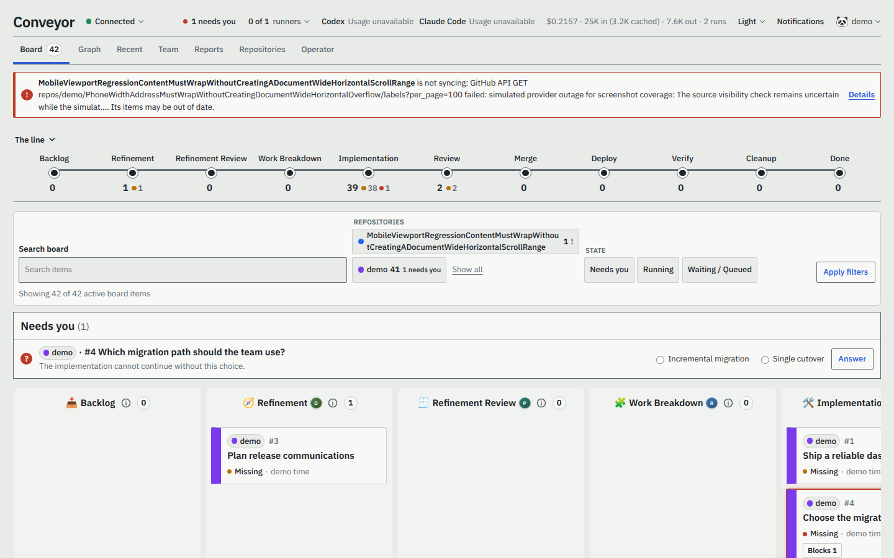

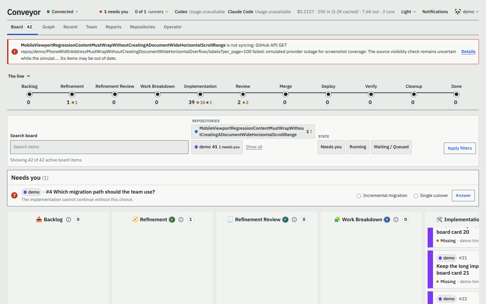

The compact filter bar narrows the cards already on the board by repository, text, and state without hiding the separate **Needs you** panel. Repository choices are filters only, and active choices stay in the URL for a reload or shared link. Use **Show all**, repository cards in the Repositories view, or repository badges on Board cards to open a repository detail page. On a phone, search and the Filters control occupy the collapsed bar; selected choices and Clear filters remain directly below it.

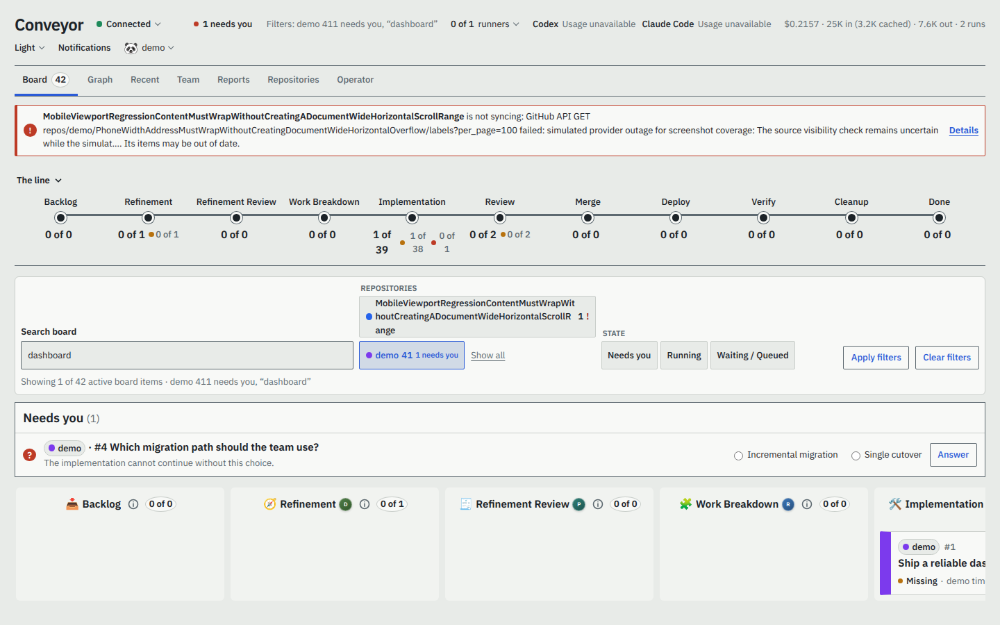

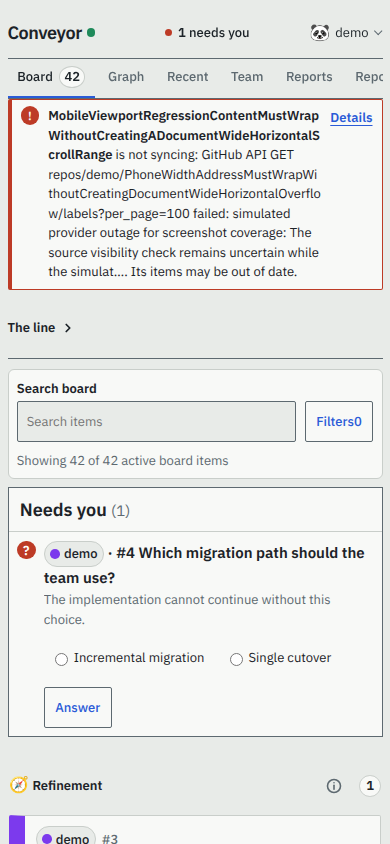

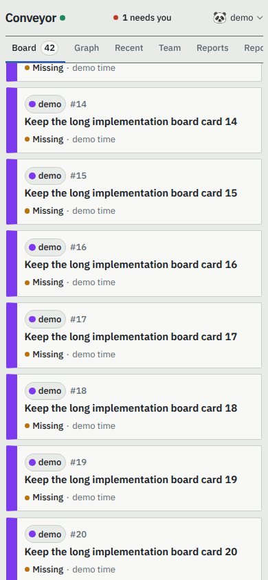

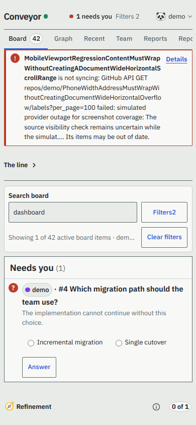

## Graph

**Graph** (`/graph`) is a read-only relationship-first view across configured repositories. It draws an SVG for every current workflow item, including backlog, roll-up, child, and label-problem items; a completed or offboarded item appears only when it is a direct parent, child, prerequisite, or dependent of a current item. Unrelated history is not imported. Each box has a repository-colour strip, repository and issue number, a shortened title, state, and optional stage. Its full title remains available to assistive technology.

Solid directed lines show **Parent → child** links; dashed directed lines show prerequisite-to-dependent links and are labelled **Met**, **Waiting**, or **Blocked**. The stable layout separates unrelated families and dependency chains. Selecting a box with a pointer or keyboard opens the existing item details. Context boxes have a labelled dashed treatment, and stopped boxes and prerequisites are labelled, so meaning never depends on colour. The screen-reader-only relationship list states every visible connection and dependency status in text.

Repository and stage controls select current matching items while retaining one directly connected context item where it explains a relationship. Choices remain in the URL and **Clear filters** restores the complete graph. The graph refreshes with the dashboard's live updates. On a phone, the SVG scrolls horizontally inside its own panel; the page itself remains within the viewport.

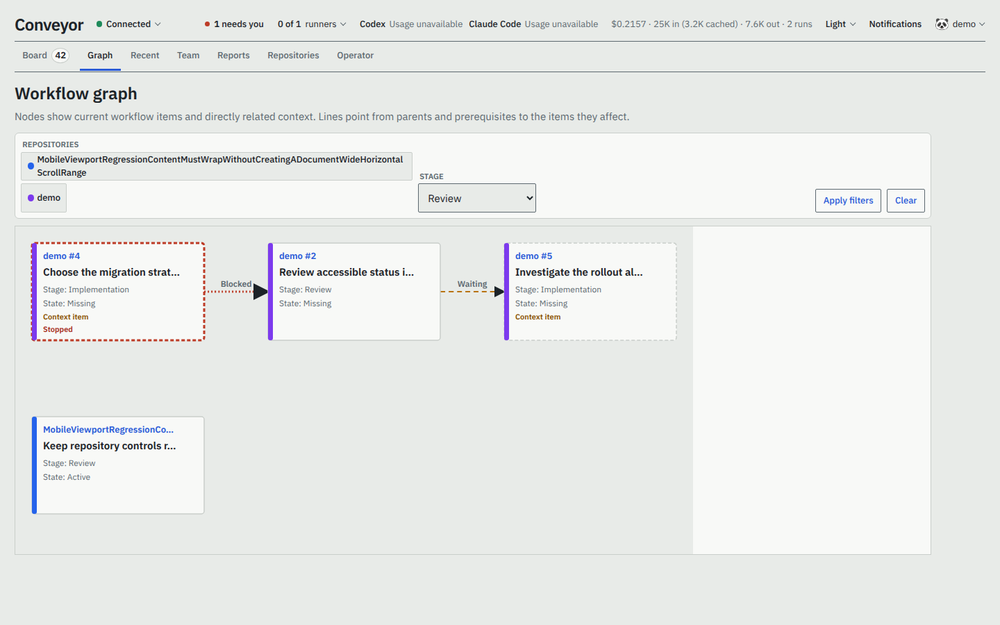

## Recent activity

**Recent** (`/recent`) is a read-only, all-repository activity feed for every signed-in dashboard account. It starts with the preceding 24 hours, newest first, and **Load more** continues backwards past that initial range with a stable time-and-event cursor. The initial range boundary is itself a time-only cursor, so records at that boundary are not repeated. Each row links to the item, names its repository, shows its relative time with the exact timestamp available on hover or keyboard focus, and can expand its recorded reason.

The feed derives rows from completed stage transitions and existing completion records; it does not keep a separate history table. Its categories are **Done** (green), **Stopped** (red), **Sent back** (orange), **Moved forward** (blue), and **New**, **Restarted / resumed**, and **Roll-up** (grey). Corrections and observations use their recorded result and the repository pipeline's stage direction. Roll-up is hidden until selected.

Done is independent of stage movement: Conveyor uses the stored `done` push-event timestamp when an item enters done. For an older completed item with no such record, it uses the merged pull request's `merged_at` timestamp. The fallback is never added when a recorded Done event exists, so one completion produces one Done row.

Select any combination of type chips and repositories; selections, including page cursors, are query parameters in the URL, so the resulting view can be reloaded, bookmarked, or opened on a phone. For example, `/recent?type=done&type=stopped&repo=sample` shows Done and Stopped events from `sample`.

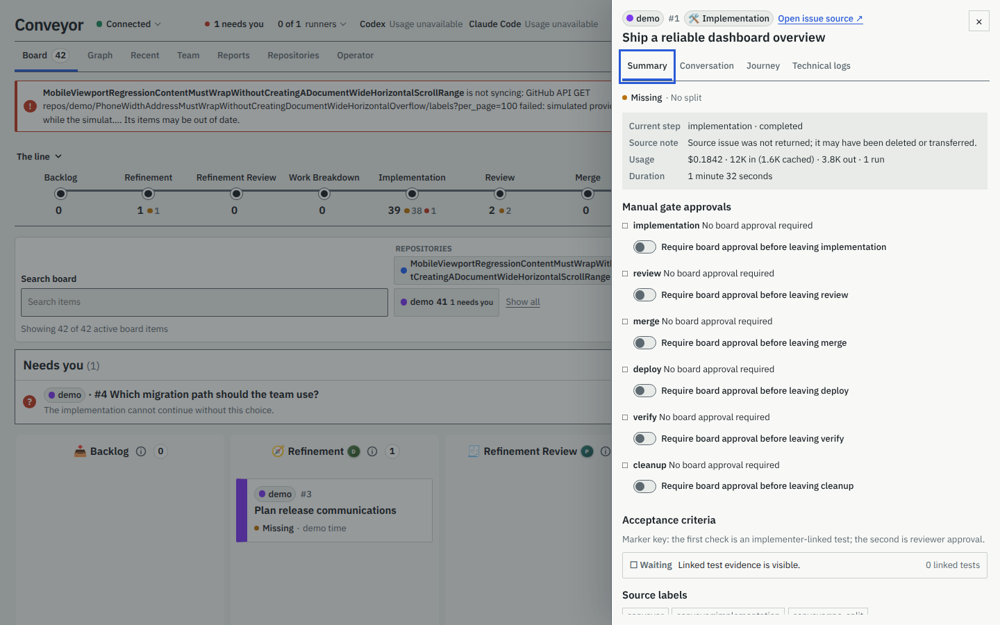

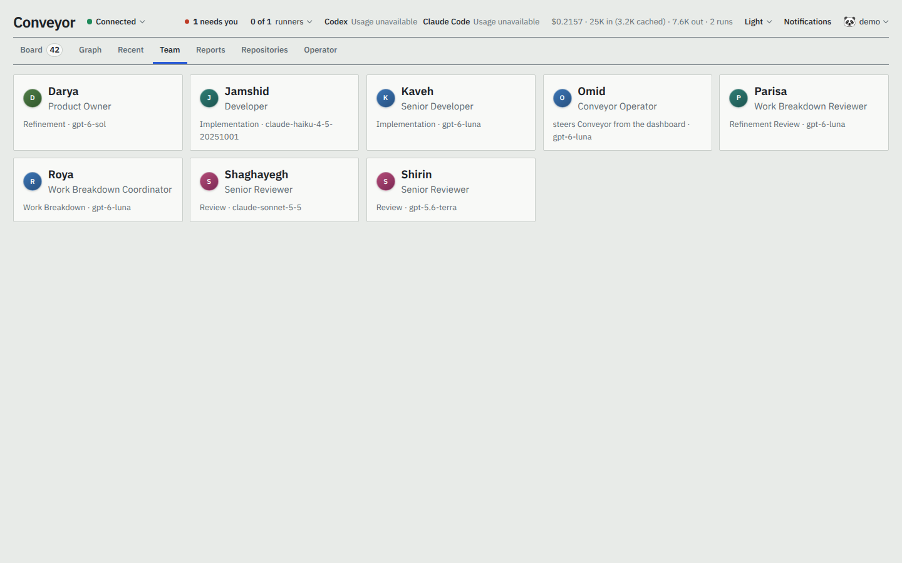

**Team** (`/team`) lists every configured agent, each opening a read-only profile (`/team/<id>`) showing its harness, model, effort, workspace access, the pipeline stages it works in, its granted tools, and its instructions.

## Keyboard and assistive technology

Every view has its own page title, and a **Skip to content** link is the first tab stop. Issue and agent cards open from the button in their title with Enter or Space; inside an item, the arrow keys, Home and End move between Summary, Conversation, Journey and Technical logs, and Escape closes it and returns to the card. Following a link moves to the start of the new view. Live updates keep the focused control and anything half-entered, such as a draft message in an open item.

A live update does not reload the page. Only the cards that changed are redrawn; a card that did not change keeps its place in the page. If cards appear or move above the one you are reading, the page scrolls by the same distance, so that card stays where it was on the screen. If that card disappears, the scroll offsets you had are kept. A scroll still under way is never reset.

When a dashboard returns to the foreground, receives focus, comes back online, or is restored from browser history, it checks its stream at once, and it checks every five seconds while open. The server sends a keep-alive event every four seconds; a stream that has been silent for twelve seconds, or that the browser closed, is opened again from the last patch the page applied, so nothing is missed. If the server cannot be reached, the page tries again after 1, 2, 4 and up to 30 seconds. While the stream is down, the header says **Reconnecting…**. If the session has ended, the page goes to the sign-in form and returns to the same address afterwards.

## Repositories

The Board's compact repository filters show repositories with active board work, plus any degraded repository, while **Show all** opens the dedicated repository view. Individual filter choices do not navigate away from the Board. The dedicated pages retain the full cards with each repository's id and address, current health, and active work.

**Repositories** (`/repositories`) lists every configured repository with its id, address, health, and current work. A degraded repository is also called out above the Board's line with its error and page link, since its items may be out of date. Select one to open `/repositories/<id>`, which provides its current delivery status, recent work, and **Setup**. Setup shows the provider configuration to every signed-in user, but only superusers see the local folder and agent egress hosts.

A superuser can **Pause** a repository from its detail page, optionally recording why, and later **Resume** it there. A paused badge appears in the repository list, Board filter, detail page, and its Board cards; the detail page records who paused it and when. Conveyor may still refresh GitHub reads, and a process run already under way is allowed to finish, but it admits no new work and performs no GitHub, code-host, or CI write for that repository until it resumes. Its items, cursors, approvals, journals, costs, and worktrees remain intact, so resumption continues eligible items from their stored step. This is separate from pausing an item, which changes that item's enrollment label, and from removing a repository from configuration, which removes its local operational records.

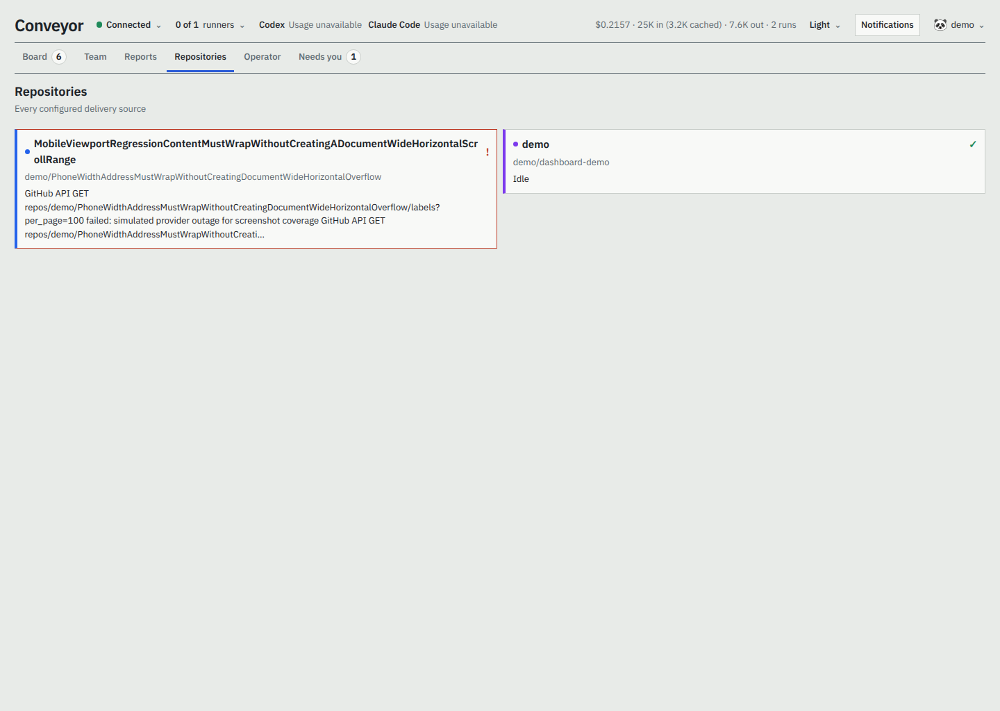

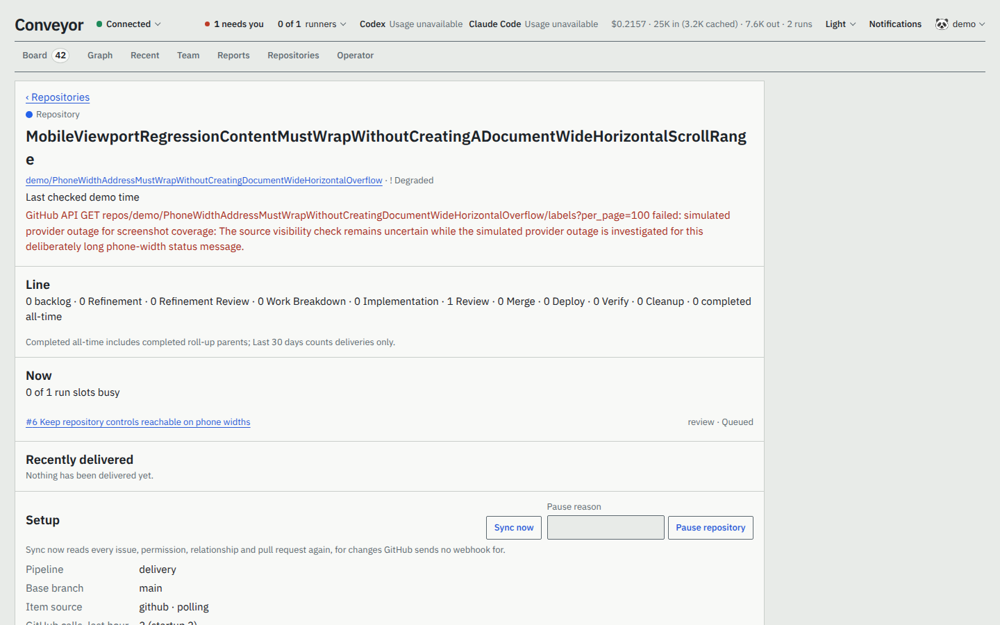

**Reports** (`/reports`, drill into one repository with `/reports/<repository>`, filter with `?period=7d|30d|90d|12m`, all time by default) show delivery, usage and time: items delivered and in progress, runs (and how many did not succeed), tokens and their cached share, agent time, and per delivered item the average tokens, runs, lead time (enrolled to done), returns and first-pass rate. It breaks an item's lead time into agents working, waiting on CI and checks, waiting for you (stopped) and queued, and shows tokens and agent time per stage, per repository and per month. A repository's page lists its items with the same figures, each linking to the item. An item counts as delivered when it finishes its last stage; done items imported without that record are left out and counted in a note.

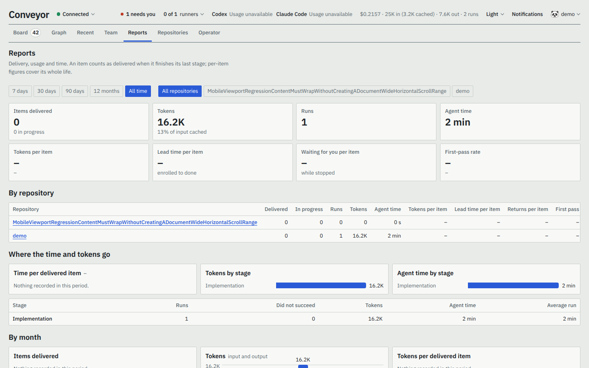

The optional steering agent is intentionally quieter than the technical log. Only explicit MCP progress and the final report are shown; commands, tool calls, raw output, and private reasoning are not rendered.

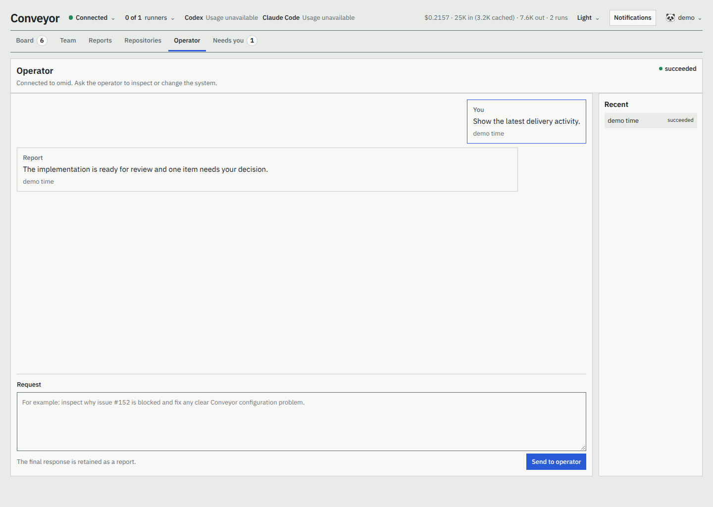

## Browser push notifications

Serve the dashboard over HTTPS (a reverse proxy can provide TLS), then configure `web.push` with a VAPID public/private key pair and an `https:` or `mailto:` contact subject. Generate a pair with `bunx web-push generate-vapid-keys`, and keep the private key in `secrets.yaml`. Restart Conveyor after changing the keys. Without all three values, the dashboard still works and shows push as unavailable.

Signed-in users can opt in separately to new questions, newly stopped issues, and issues reaching done from **Notifications** in the dashboard. Every category starts off. Enabling a category asks the browser for notification permission and registers that browser; users can turn categories off at any time, and turning all of them off or signing out removes that browser's server-side subscription. Push requires HTTPS, service workers, the Push API, and the Notifications API. Browsers that do not implement those APIs, or that restrict push for installed web apps, cannot receive alerts; the settings page reports unsupported or denied permission states.
